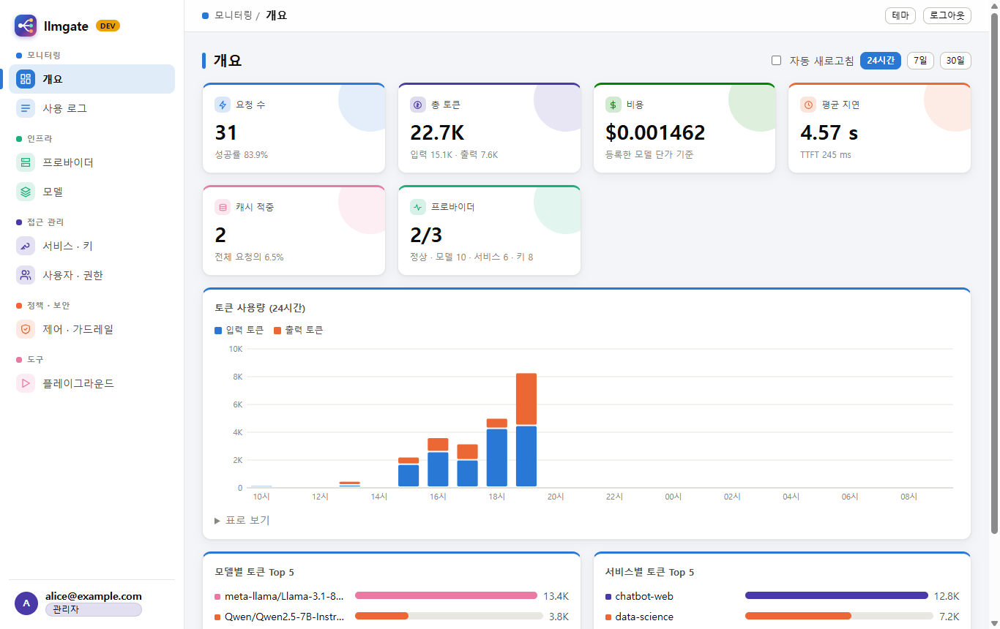
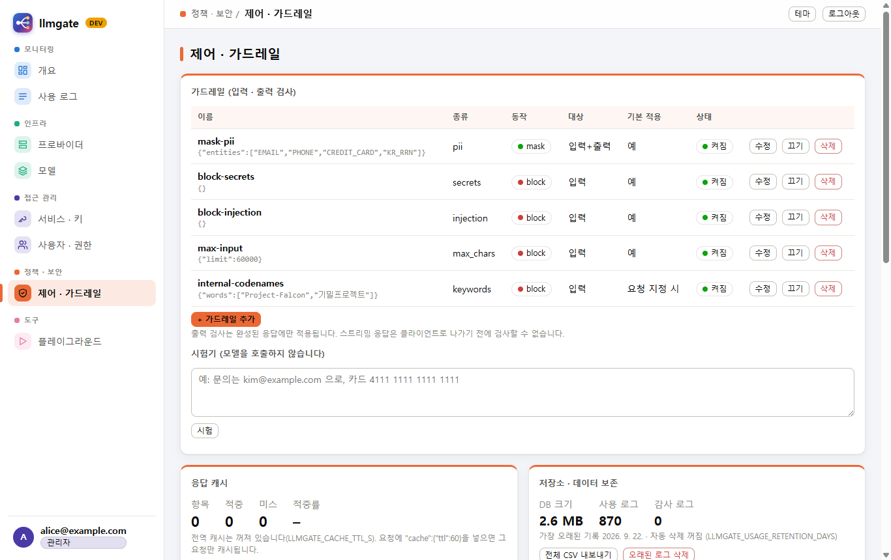
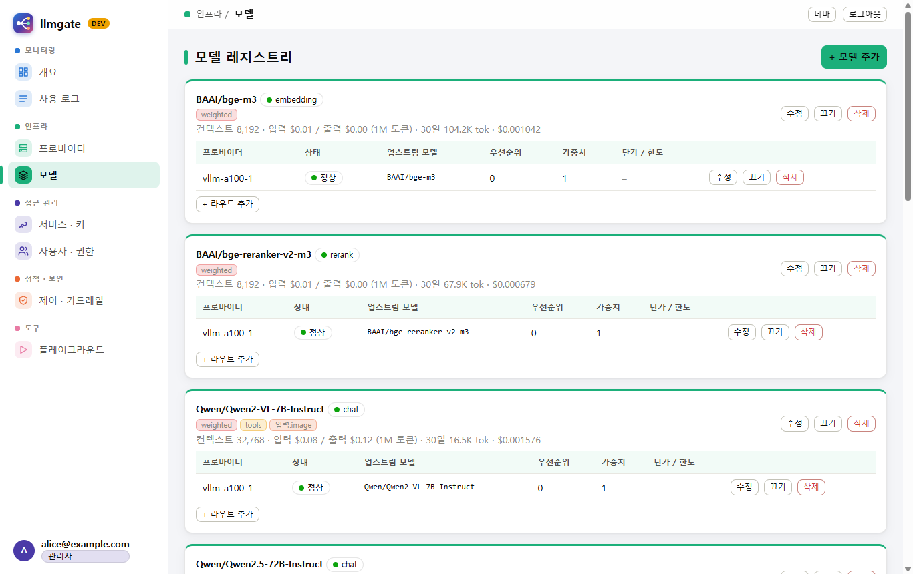
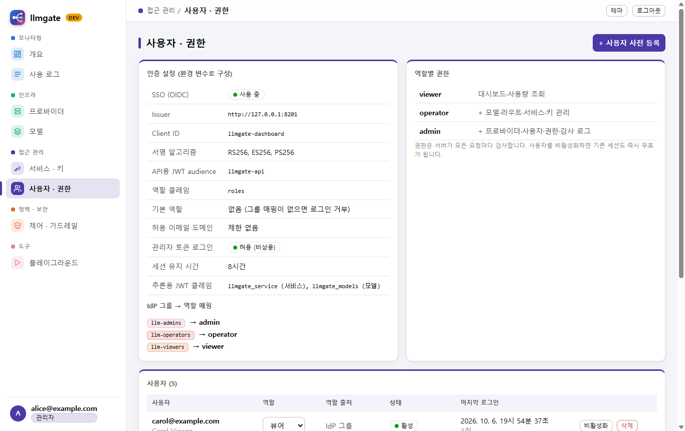

# llmgate

<p><a href="README.md" lang="ko">한국어</a> · <strong lang="en">English</strong></p>

An **OpenRouter-style gateway that sits in front of self-hosted LLM engines** such as vLLM, Ollama and TGI.
It provides a model registry, service/API key management, token and cost tracking, routing/fallback, SSO (OIDC)/JWT authentication and role-based access control in a single service,
and follows the API shapes of [OpenRouter](https://openrouter.ai) and the [LiteLLM proxy](https://github.com/BerriAI/litellm) so existing SDKs and scripts work as they are.
Projects it draws on: LiteLLM (virtual keys, budgets, router), new-api / one-api (channels, quotas, dashboard), OpenRouter (catalog, `provider` routing, `gen-` IDs).

```
Client ──(OpenAI / OpenRouter / Anthropic format)──▶ llmgate ──▶ vLLM #1 · vLLM #2 · Ollama · ...
                                          │   key auth · limits/budgets · guardrails · cache · routing · fallback
                                          └──▶ SQLite (usage logs, registry) · Prometheus /metrics · webhooks
Browser ──(OIDC SSO)──▶ Dashboard (Overview · Providers · Models · Services/Keys · Controls · Logs · Playground · Users/Permissions)
```

> **vLLM is replaced by a mock.** `mockvllm/` imitates vLLM's OpenAI-compatible server
> (`/v1/chat/completions` streaming and `usage`, `/v1/responses`, `/v1/messages`, `/v1/rerank`, `/health`, `vllm:*` metrics on `/metrics`, fault injection).
> There is also a mock IdP for SSO development (`mockoidc/`). For a real engine, just change the provider's `base_url`.

## Quick start (development)

```bash
pip install -e ".[dev]"
llmgate dev                       # (or python -m llmgate dev) 2 mock vLLMs + SSO auto-login + sample data + auto-restart + persistent DB
llmgate dev --as carol            # auto-login as a viewer (bob=operator). --as none shows the user picker
llmgate dev --no-sso              # without SSO: log in with the admin token dev-admin
llmgate dev --no-mock             # with real vLLM: Dashboard > Add provider (http://gpu:8000/v1) > Sync models
```

- Dashboard <http://127.0.0.1:8080/dashboard/> — opening it **logs you in directly as alice (admin) with no login form** (token login is `dev-admin`) · API docs at `/docs` · all seeded keys are in `data/dev-credentials.json`
- **Sample data** is loaded on first run: 10 models · 6 services / 9 keys · 5 guardrails · about 870 usage records covering 14 days (disable with `--no-seed`; for another DB use `llmgate seed`)
- With the OpenAI SDK: `base_url="http://127.0.0.1:8080/v1"` (OpenRouter style is `/api/v1`), `python examples/quickstart.py`
- If the port is already in use it automatically moves to the next free port and shows the actual address in the banner. If it still does not start, see [When the server does not start](docs/development.md#서버가-안-뜰-때) (Korean).
- Saving code restarts the server and keeps the SSO session. For options, tests and the code map see **[docs/development.md](docs/development.md)** (Korean).
- For a walkthrough demo with data filled in, run `python -m llmgate.demo` (reset on every run).

> Development-mode secrets (`dev-admin` etc.) are public values. In production, set them explicitly with the environment variables below.

```bash
LLMGATE_ADMIN_TOKEN=change-me llmgate --port 8080      # production-style run (no auto-restart, no mocks)
```

If you were using LiteLLM, `llmgate import-litellm config.yaml` imports your `model_list`/`router_settings`.

## Screens

| | |
|---|---|
|  |  |
| Overview: metric cards, token chart, model/service rankings | Controls: guardrail tester, cache, storage/retention |
|  |  |
| Model registry: routes, fallbacks, pricing | Users/permissions: SSO roles, audit log |

The dashboard UI is currently Korean-only.

The left sidebar is split into 5 categories (Monitoring · Infrastructure · Access · Policy/Security · Tools), each with its own color. Dark theme and mobile (drawer menu) are supported.

## What's inside

| Area | Features |
|---|---|
| **Gateway** | Both `/v1` and `/api/v1` (OpenRouter path): chat · completions · embeddings · **responses** · **messages** (Anthropic) · **rerank**, SSE streaming, accurate stream `usage` accounting (estimated when the engine does not report it) |
| **Registry** | Providers (vLLM/Ollama/TGI…, health checks, `/metrics` scraping) · Models (pricing, context, supported parameters, modalities) · Routes (priority, weight, per-provider pricing, RPM/TPM/concurrency) · Aliases |
| **Routing** | Per-request `provider` options (order · only · ignore · allow_fallbacks · sort · data_collection · quantizations · max_price · require_parameters), `:nitro` `:floor` `:free`, `models` fallback array, `llmgate/auto`, strategies (weighted · least-busy · latency · cost · usage), cooldown, retries, per-model fallback / context fallback |
| **Keys & budgets** | Services (teams) · API keys · RPM/TPM/concurrent requests · token/USD budgets · **budget periods (1h/7d/30d)** · per-model budgets · allowed models/providers · expiry · rotation · end-user (`user`) budgets/blocking · spend by tag/app (`X-Title`) |
| **Protection** | Guardrails (PII · secrets · banned words · regex · prompt injection · length: block/mask, input + output) · response cache · `middle-out` transform |
| **Auth & permissions** | **OIDC SSO (Authorization Code + PKCE)**, session JWT cookie, **IdP JWT** (JWKS verification) for admin API and inference API access, **RBAC** (viewer/operator/admin), claim-to-role mapping, user management and pre-registration, audit log → [docs/auth.md](docs/auth.md) (Korean) |
| **Security** | Dashboard CSP and security headers, auth failure limiting (brute-force defense), encryption of upstream keys at rest (+ rotation) → [docs/operations.md](docs/operations.md) (Korean) |
| **Data** | Usage log export to CSV/JSONL, automatic retention cleanup, online backup (`llmgate backup`), storage status |
| **Observability** | Usage logs, aggregates and time series, Prometheus `/metrics`, usage webhook (metadata only), Slack-compatible alerts (provider down, budget threshold) |
| **Compatible APIs** | OpenRouter: `/api/v1/models` (+ filters) · `/models/{id}/endpoints` · `/providers` · `/key` · `/credits` · `/generation` · `/keys` · LiteLLM: `/key/*` `/team/*` `/customer/*` `/spend/*` `/global/spend/*` `/model/*` `/health*` `/utils/token_counter` → [docs/compat.md](docs/compat.md) (Korean) |

## Configuration (environment variables `LLMGATE_*` or `.env`)

The full list is in [`.env.example`](.env.example) and `llmgate/config.py`. Commonly used:

| Variable | Default | Description |
|---|---|---|
| `ADMIN_TOKEN` | `admin-change-me` | Emergency admin token (always admin). **Must be changed.** Can be disabled with `ADMIN_TOKEN_ENABLED=false` |
| `DATABASE_PATH` | `data/llmgate.db` | SQLite file |
| `OIDC_ISSUER` / `OIDC_CLIENT_ID` / `OIDC_CLIENT_SECRET` | – | Setting these enables SSO |
| `OIDC_ROLE_MAP`, `OIDC_ROLES_CLAIM`, `OIDC_DEFAULT_ROLE` | `llm-admins→admin` …, `roles`, `none` | IdP groups → roles. Login is refused when there is no mapping (`none`) |
| `JWT_SECRET` | random per process | Session JWT signing key (≥32 chars). Set it to keep sessions across multiple workers or restarts |
| `CACHE_TTL_S` | `0` | If >0, identical non-streaming requests are cached (also controllable per request via `"cache"`) |
| `UPSTREAM_RETRIES`, `COOLDOWN_AFTER_FAILS`, `COOLDOWN_S` | `0`, `3`, `30` | Retries / cooldown |
| `USAGE_WEBHOOK_URL`, `ALERT_WEBHOOK_URL` | – | Usage broadcast / alerts |
| `ENCRYPTION_KEY` | – | Encrypts provider API keys at rest (`llmgate genkey`) |
| `AUTH_FAIL_LIMIT` | `30` | Rejected credentials per address per minute (0=off) |
| `USAGE_RETENTION_DAYS` | `0` | Usage log retention in days (0=forever) |
| `PUBLIC_CATALOG` | `true` | Whether `/api/v1/models` etc. are public without a key |

## Tests

```bash
python -m pytest        # 141 tests: proxy/fallback/streaming · SSO flow/RBAC/JWT forgery · OpenRouter/LiteLLM compat · guardrails/cache/alerts
```

The tests start the mock vLLM and mock IdP on **real ports** and talk to the gateway over the actual network.

## Known limits (honestly)

- **Only OpenAI-compatible upstream engines** are supported (or engines that natively serve `messages`/`responses`/`rerank`). There is no SDK translation for 100+ SaaS providers like LiteLLM has.
- **Output guardrails cannot be applied to streaming responses**, and the cache only covers non-streaming requests.
- Token estimation (when the engine does not report `usage`) is approximate (English ~4 chars/token, CJK 1 char/token).
- RPM, concurrency and cooldown state live in **process memory** (single instance). Multiple instances need a shared store such as Redis.
- **TLS is not handled directly** (terminate it at a front proxy). Performance measurements and their limits are in [docs/operations.md](docs/operations.md#성능-측정-그리고-한계) (Korean) — about 300 req/s with a single worker; the effect of scaling workers was not demonstrated.
- Storage is SQLite (for small to medium traffic). Docker was not available in this environment, so the `Dockerfile`/`docker-compose.yml` **have not been built.**
- Not included: OpenRouter's web search (`:online`), PDF parser, BYOK, credit payments and image generation; LiteLLM's Redis/semantic cache, Langfuse callbacks and batch/files/assistants APIs. See [docs/compat.md](docs/compat.md) (Korean) for the full mapping table.

## License

[MIT](LICENSE) © 2026 kos2001
